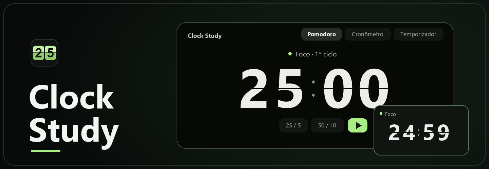

<p align="center">
  
</p>

<h1 align="center">Clock Study</h1>
<p align="center">A flip clock for focused work, with Pomodoro, a countdown timer, and a stopwatch.</p>
<p align="center">
  <strong><a href="https://github.com/daniel-18212/clock-study/releases">Download Clock Study</a></strong>
  · <a href="README.pt-BR.md">Português (Brasil)</a>
  · <a href="#build-and-release">Build from source</a>
</p>

## Get started

1. Download the package for your system from [Releases](https://github.com/daniel-18212/clock-study/releases).
2. Open Clock Study, choose a timer, and press **Play**.
3. On desktop, select **Flutuar** to keep the timer in a small resizable window while you work. Select **Expandir** to return to the main window.

| System | Download | Open it |
| --- | --- | --- |
| **Windows 11 x64** | `*-setup.exe` | Run the installer. It includes the offline WebView2 installer. |
| **macOS · Apple Silicon and Intel** | `*.dmg` | Open the disk image and drag Clock Study into Applications. |
| **Ubuntu / Debian x64** | `*.deb` | Open the package with your package manager. |
| **Compatible Linux x64** | `*.AppImage` | Mark the file as executable and open it. Some distributions require FUSE. |
| **Android ARM64** | `*_android-arm64.apk` | On your phone, open the downloaded APK and follow Android's installation prompt. |

In portrait, the flip digits stack vertically, including when the timer displays hours. In landscape, the time sits in a wide row beside the presets and playback controls.

Allow notifications on the first Android launch to receive Pomodoro and countdown alerts with the screen locked. Android's notification and Do Not Disturb settings control whether the alert plays sound. Force-stopping the app cancels its alarms.

> [!NOTE]
> The current release is a preview. Windows Smart App Control and macOS Gatekeeper may block packages without a trusted signature or Apple notarization. The Android preview uses a temporary signing key. If a later APK uses a different key, uninstall the previous preview before installing it. On Linux Wayland, the desktop compositor controls whether the floating window stays above other apps.

## Choose your timer

| Mode | Use it for |
| --- | --- |
| **Pomodoro** | Set focus time, short and long breaks, and how many focus blocks come before a long break. |
| **Countdown** | Set hours, minutes, and seconds. Click the digits to edit the duration. |
| **Stopwatch** | Count up and record laps. |

Clock Study works offline and saves durations and window sizes on the device. The app interface is in Brazilian Portuguese.

## Build and release

<details>
<summary>Local development</summary>

Install Node.js 22, Rust, and the [Tauri prerequisites](https://v2.tauri.app/start/prerequisites/) for your system.

```sh
npm install
npm run tauri dev
```

Run the packaging command on the target system. For Android, set up the SDK, NDK and `aarch64-linux-android` Rust target first. Use the signed APK from GitHub Releases for installation.

| System | Command |
| --- | --- |
| Windows | `npm run tauri build -- --bundles nsis` |
| macOS | `npm run tauri build -- --bundles dmg` |
| Linux | `npm run tauri build -- --bundles deb,appimage` |
| Android ARM64 | `bash packaging/android/prepare.sh` then `npm run tauri android build -- --apk --target aarch64` |

</details>

<details>
<summary>GitHub Releases and Microsoft Store</summary>

The [package workflow](.github/workflows/desktop.yml) builds Windows, macOS, Linux and Android. A version bump on `main` publishes a prerelease with the installers and SHA-256 checksums once all builds succeed.

Update the version in `package.json`, `src-tauri/Cargo.toml`, and `src-tauri/tauri.conf.json`. Add notes in both languages to `docs/releases/`. Update both READMEs in the same change when installation, usage, or build steps change.

For Android updates that install over a previous version, configure a persistent keystore through the Actions secrets `ANDROID_KEYSTORE_BASE64`, `ANDROID_KEYSTORE_PASSWORD`, `ANDROID_KEY_ALIAS` and `ANDROID_KEY_PASSWORD`.

For the Microsoft Store, create an MSIX product in [Partner Center](https://partner.microsoft.com/dashboard). Set the repository Actions variables `STORE_IDENTITY_NAME`, `STORE_PUBLISHER`, and `STORE_PUBLISHER_DISPLAY_NAME` using **Product identity**. Run **Clock Study Packages** with **Prepare an MSIX for Microsoft Store submission** selected. Microsoft signs the MSIX after certification.

</details>

## Contact

**Daniel Rodrigues** · [daniel_18212@hotmail.com](mailto:daniel_18212@hotmail.com)
