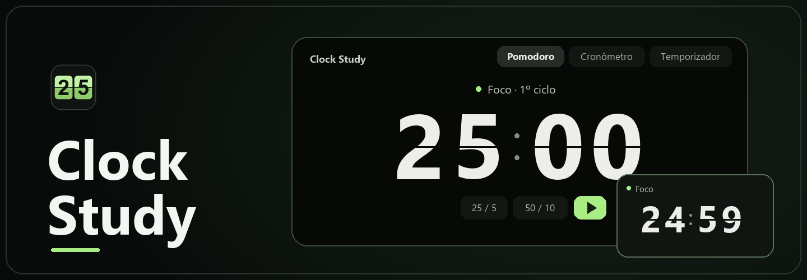

<p align="center">
  
</p>

<h1 align="center">Clock Study</h1>
<p align="center">Um relógio flip para estudar, com Pomodoro, temporizador e cronômetro.</p>
<p align="center">
  <strong><a href="https://github.com/daniel-18212/clock-study/releases">Baixar o Clock Study</a></strong>
  · <a href="README.md">English</a>
  · <a href="#compilar-e-publicar">Compilar o código</a>
</p>

## Primeiros passos

1. Baixe o pacote do seu sistema na página de [Releases](https://github.com/daniel-18212/clock-study/releases).
2. Abra o Clock Study, escolha um modo e pressione **Play**.
3. No computador, selecione **Flutuar** para acompanhar a contagem numa janela pequena e redimensionável. Clique em **Expandir** para voltar à janela principal.

| Sistema | Download | Como abrir |
| --- | --- | --- |
| **Windows 11 x64** | `*-setup.exe` | Execute o instalador. Ele inclui o instalador offline do WebView2. |
| **macOS · Apple Silicon e Intel** | `*.dmg` | Abra a imagem de disco e arraste o Clock Study para Aplicativos. |
| **Ubuntu / Debian x64** | `*.deb` | Abra o pacote no gerenciador de pacotes. |
| **Linux x64 compatível** | `*.AppImage` | Marque o arquivo como executável e abra. Algumas distribuições precisam de suporte ao FUSE. |
| **Android ARM64** | `*_android-arm64.apk` | No celular, abra o APK baixado e siga a confirmação de instalação do Android. |

Em retrato, os dígitos ficam empilhados, inclusive quando o relógio exibe horas. Em paisagem, o tempo fica em uma linha ampla, ao lado dos atalhos e controles.

Permita notificações na primeira abertura para receber os avisos do Pomodoro e do temporizador com a tela bloqueada. As configurações de notificações e do modo Não Perturbe do Android controlam o som do aviso. Forçar a parada do app cancela os alarmes.

> [!NOTE]
> A versão atual é uma prévia. O Controle Inteligente de Aplicativos do Windows e o Gatekeeper do macOS podem bloquear pacotes sem assinatura confiável ou notarização da Apple. A prévia para Android usa uma chave de assinatura temporária. Se um APK posterior usar outra chave, desinstale a prévia anterior antes de instalá-lo. No Linux com Wayland, o ambiente gráfico decide se a janela flutuante fica acima de outros aplicativos.

## Escolha o modo

| Modo | Para que serve |
| --- | --- |
| **Pomodoro** | Ajuste o foco, as pausas curta e longa e quantos blocos vêm antes da pausa longa. |
| **Temporizador** | Defina horas, minutos e segundos. Clique nos números para editar a duração. |
| **Cronômetro** | Conte o tempo decorrido e registre voltas. |

O Clock Study funciona offline e salva as durações e os tamanhos das janelas no dispositivo. A interface está em português do Brasil.

## Compilar e publicar

<details>
<summary>Desenvolvimento local</summary>

Instale Node.js 22, Rust e os [pré-requisitos do Tauri](https://v2.tauri.app/start/prerequisites/) para seu sistema.

```sh
npm install
npm run tauri dev
```

Execute o comando de empacotamento no sistema de destino. Para Android, configure antes o SDK, o NDK e o alvo Rust `aarch64-linux-android`. Para instalar, use o APK assinado disponível no GitHub Releases.

| Sistema | Comando |
| --- | --- |
| Windows | `npm run tauri build -- --bundles nsis` |
| macOS | `npm run tauri build -- --bundles dmg` |
| Linux | `npm run tauri build -- --bundles deb,appimage` |
| Android ARM64 | `bash packaging/android/prepare.sh` e depois `npm run tauri android build -- --apk --target aarch64` |

</details>

<details>
<summary>GitHub Releases e Microsoft Store</summary>

O [workflow de empacotamento](.github/workflows/desktop.yml) compila para Windows, macOS, Linux e Android. Uma mudança de versão em `main` publica uma prévia com os instaladores e as somas SHA-256 depois que todos os builds passam.

Atualize a versão em `package.json`, `src-tauri/Cargo.toml` e `src-tauri/tauri.conf.json`. Adicione notas nos dois idiomas em `docs/releases/`. Atualize os dois READMEs na mesma alteração quando mudar a instalação, o uso ou a compilação.

Para instalar atualizações do Android sobre uma versão anterior, configure uma chave persistente nos segredos do Actions `ANDROID_KEYSTORE_BASE64`, `ANDROID_KEYSTORE_PASSWORD`, `ANDROID_KEY_ALIAS` e `ANDROID_KEY_PASSWORD`.

Para a Microsoft Store, crie um produto MSIX no [Partner Center](https://partner.microsoft.com/dashboard). Defina as variáveis do Actions `STORE_IDENTITY_NAME`, `STORE_PUBLISHER` e `STORE_PUBLISHER_DISPLAY_NAME` com os dados de **Identidade do produto**. Execute **Clock Study Packages** com **Prepare an MSIX for Microsoft Store submission** selecionado. A Microsoft assina o MSIX após a certificação.

</details>

## Contato

**Daniel Rodrigues** · [daniel_18212@hotmail.com](mailto:daniel_18212@hotmail.com)
